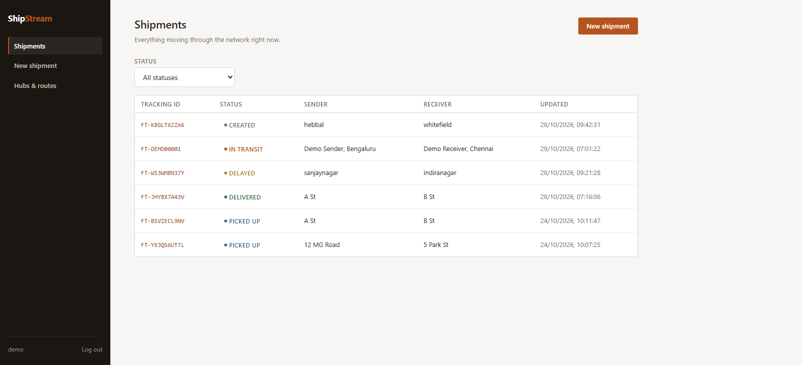
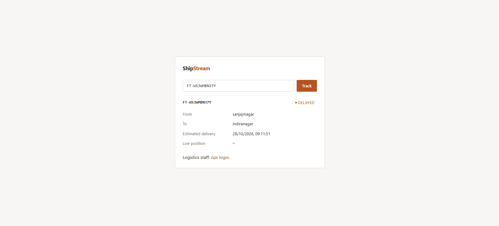
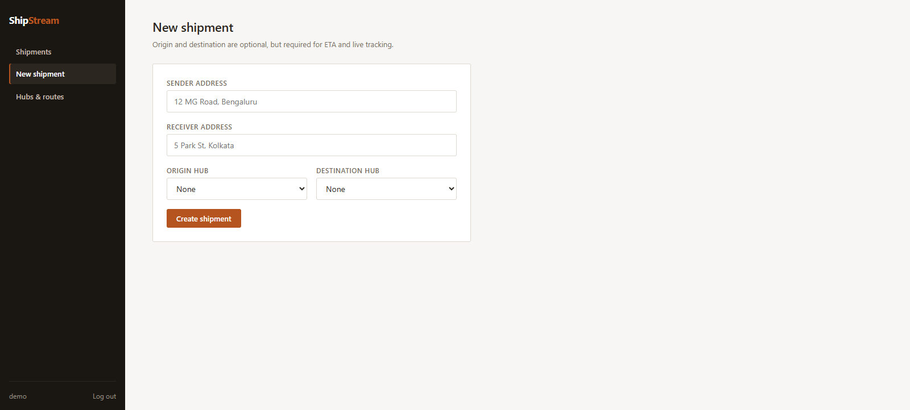
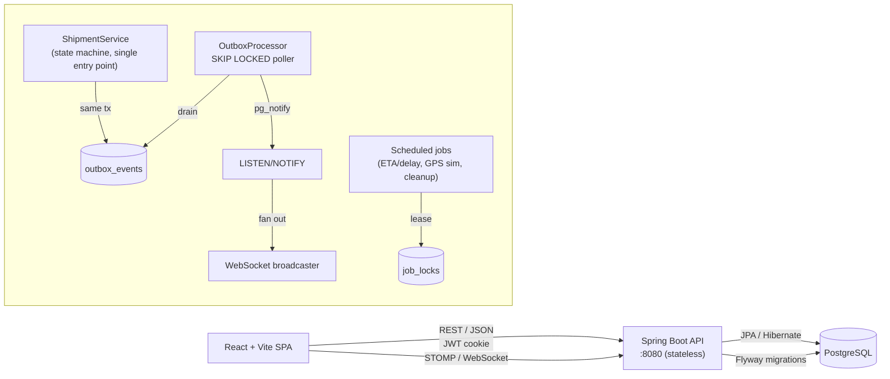

<p align="center">
  
</p>

<h1 align="center">ShipStream</h1>
<p align="center"><b>Real-time logistics & shipment tracking</b> — Spring Boot, PostgreSQL, WebSockets, React</p>

<p align="center">
  
  
  
  
  
</p>

A shipment tracking system with a state machine that makes invalid transitions impossible,
optimistic-lock concurrency safety, a transactional **outbox** feeding real-time WebSocket pushes,
lease-based distributed job coordination, and a public/authenticated split modeled on how real carriers
actually split their audience — a customer tracks a package with no account, same as FedEx or DHL;
everything that changes data needs a login. Single datastore throughout (PostgreSQL only — no Redis):
Caffeine covers caching, Postgres `LISTEN/NOTIFY` covers cross-instance WebSocket fan-out.

---

## Table of contents

- [What it does](#what-it-does)
- [Screens](#screens)
- [Tech stack](#tech-stack)
- [Architecture](#architecture)
- [Notable engineering](#notable-engineering)
- [Data model](#data-model)
- [API overview](#api-overview)
- [Running locally](#running-locally)
- [Testing & CI](#testing--ci)
- [Project structure](#project-structure)
- [Deployment](#deployment)
- [Roadmap](#roadmap)
- [License](#license)

---

## What it does

| Audience | Access | Can do |
|---|---|---|
| **Public** — a customer checking a package | No account | Look up a shipment by tracking ID; see its live status, ETA and position |
| **Ops** — dispatchers/warehouse staff | JWT login (one seeded demo user) | Create shipments, advance them through the state machine, manage hubs & routes, see the full audit trail |

Core mechanics, beyond CRUD:

- **State machine** — `CREATED → PICKED_UP → IN_TRANSIT ⇄ ARRIVED_AT_HUB → OUT_FOR_DELIVERY → DELIVERED`,
  plus `DELAYED` (recoverable — resumes wherever it stalled), `LOST` and `CANCELLED` (terminal). Every
  transition is validated through one entry point; an invalid one is structurally impossible to reach,
  not just rejected by a check.
- **Concurrency safety** — `@Version` optimistic locking on shipments: two concurrent transitions race
  on the update, and the loser gets a clean `409`, not a corrupted row. Covered by a real concurrent-
  threads integration test, not a mock.
- **Transactional outbox** — a business change and its `outbox_events` row commit in the same
  transaction (no dual-write problem); a poller claims batches with `SELECT ... FOR UPDATE SKIP LOCKED`,
  so multiple instances can drain the queue without double-processing, and fans each event out via
  Postgres `NOTIFY` to every instance's locally-connected WebSocket clients.
- **ETA + live GPS simulation** — a scheduled job linearly interpolates a shipment's position between
  its origin and destination hub by elapsed time vs. ETA, driving the real-time pipeline with a
  believable feed instead of needing a real device.
- **Lease-based job coordination** — a `job_locks` table with a lease (`locked_until`) ensures a
  scheduled job (delay detection, stale-data cleanup) runs on exactly one instance at a time, even with
  several instances running the same `@Scheduled` method.
- **Auth** — stateless JWT in an httpOnly, `SameSite=Lax` cookie. One `OPS` role; the schema supports
  more without a migration, but nothing in the app needs that yet.

---

## Screens

| Ops dashboard — shipments list | Public tracking — live result |
|---|---|
|  |  |

| Create shipment |
|---|
|  |

Run locally (see [below](#running-locally)) and either track the seeded demo shipment
**`FT-DEMO00001`** with no login, or sign in as **`demo`** / **`demo1234`** for the full ops dashboard —
shipment list, create, status transitions, hub/route admin, live tracking, audit history.

---

## Tech stack

| Layer | Choices |
|---|---|
| **Backend** | Java 21, Spring Boot 4.1 (Web, Data JPA, Security, Validation, Cache, WebSocket), Hibernate 7 |
| **Database** | PostgreSQL 16, owned entirely by Flyway migrations (`ddl-auto=validate`) |
| **Auth** | Stateless JWT (`jjwt`), BCrypt, httpOnly cookie |
| **Real-time** | Spring WebSocket + STOMP, Postgres `LISTEN/NOTIFY` for cross-instance fan-out |
| **Caching** | Caffeine, in-process cache-aside |
| **Frontend** | React 18 + TypeScript, Vite, React Router, TanStack Query, `@stomp/stompjs`; plain CSS (one design-token file, no component library) |
| **CI / packaging** | GitHub Actions (`mvn verify` + `npm run build`, both also building their container image); multi-stage, non-root Dockerfiles for both apps |

---

## Architecture



**Request path:** `Controller` (thin) → `Service` (business logic, the state machine, auth-relevant
checks) → `Repository`. Every response is a DTO record, never a raw entity.

---

## Notable engineering

### Transactional outbox, not a message broker bolted on

Side effects never fire from inside the transaction that caused them. A shipment transition writes its
`shipment_events` audit row *and* an `outbox_events` row in the same transaction — so "the transition
happened" and "a broadcast is owed" commit together atomically, or not at all. A separate
`OutboxProcessor` claims batches every 2s with `FOR UPDATE SKIP LOCKED` (several instances can poll
without double-processing), publishes via `pg_notify`, and every instance's `PgNotifyListener` forwards
to its own locally-connected WebSocket clients — the mechanism that would normally need Redis pub/sub,
built on Postgres alone.

### The state machine is the only way to change status

`ShipmentStatus.canTransitionTo()` is a transition table, not a scattered set of `if` checks, and
`Shipment.transitionTo()` is the *only* method that mutates status — there's no code path that can set
an invalid one. Covered by exhaustive parameterized tests over every status pair.

### Optimistic locking, proven under real concurrency

`@Version` on `shipments`; a dedicated test fires two concurrent transition requests at the same
shipment from two threads and asserts exactly one succeeds (`200`) and the other gets a `409` —
against a real Postgres via Testcontainers, not a mock.

### Auth that matches how carriers actually work

A stranger can track a package with zero login friction; everything that mutates data sits behind a
JWT-in-httpOnly-cookie login. `SameSite=Lax` defeats the CSRF risk that cookie-based auth otherwise
reintroduces. A demo login and a demo shipment are both seeded on startup, idempotently, and shown
directly on the login/tracking pages — not just in this README.

---

## Data model

Seven Flyway migrations, delivered incrementally: `V1` hubs/routes/shipments · `V2` shipment_events
(audit trail) · `V3` shipment_tracking (live position) · `V4` outbox_events · `V5` job_locks ·
`V6` hub coordinates + ETA + extra statuses · `V7` users.

Full design rationale, every decision and why, phase by phase: [docs/DESIGN.md](docs/DESIGN.md).

---

## API overview

```
PUBLIC (no login)
GET  /api/v1/shipments/track/{trackingId}
GET  /api/v1/tracking/{shipmentId}
WS   /ws  → /topic/shipments/{trackingId}
POST /api/v1/auth/login

OPS LOGIN REQUIRED
POST /api/v1/shipments · GET /api/v1/shipments?status=&page=&size= · GET /api/v1/shipments/{id}
POST /api/v1/shipments/{id}/status          state machine transition
GET  /api/v1/shipments/{id}/events          audit trail
POST /api/v1/tracking/update
POST /api/v1/hubs · GET /api/v1/hubs · GET /api/v1/routes
GET  /api/v1/auth/me · POST /api/v1/auth/logout
```

---

## Running locally

```bash
docker compose up -d                  # Postgres :5433, from the repo root
cd backend && ./mvnw spring-boot:run  # :8080 — must run from backend/, not the repo root
```
```bash
cd frontend && npm install && npm run dev   # :5173
```

Demo credentials (seeded automatically, shown on-screen): ops login **`demo`** / **`demo1234`**, demo
tracking ID **`FT-DEMO00001`**. See [`backend/.env.example`](backend/.env.example) and
[`frontend/.env.example`](frontend/.env.example) for every configurable variable.

---

## Testing & CI

```bash
cd backend  && ./mvnw verify    # 40 tests — real Postgres via Testcontainers
cd frontend && npm run build    # tsc typecheck + Vite build
```

Backend tests cover the state machine exhaustively, a real concurrent-threads optimistic-lock race, the
outbox/notify pipeline, tracking, ETA, the full auth pipeline (unauthenticated `401`, a real login round
trip, the public/protected split), and the REST API end to end. `GitHub Actions` runs both jobs — plus a
container image build for each — on every push and PR.

---

## Project structure

```
backend/
  src/main/java/com/shipstream/
    shipment/    state machine, ShipmentService (single entry point), controllers, DTOs
    hub/         hubs & routes
    tracking/    live position, GpsSimulator
    outbox/      OutboxEvent, OutboxProcessor (SKIP LOCKED)
    realtime/    WebSocket config, Postgres LISTEN/NOTIFY publisher + listener
    jobs/        JobLock, JobLockService, ScheduledJobs (delay detection, cleanup)
    auth/        JWT, SecurityConfig, DemoUserSeeder
    demo/        DemoDataSeeder (seeds the public demo shipment)
    common/      shared exceptions, ProblemDetail error handling, cache config
  src/main/resources/db/migration/   V1..V7
  Dockerfile     multi-stage: Maven build → JRE-alpine runtime, non-root
frontend/
  src/
    pages/       one per screen (public tracking, login, shipments list/detail/create, hubs)
    hooks/       useAuth, useShipmentSocket (STOMP)
    components/  Layout, RequireAuth, ErrorBoundary, shared UI
    styles/      theme.css — the entire design system, one file
  Dockerfile     multi-stage: Vite build → nginx (SPA fallback)
docker-compose.yml       Postgres for local dev
.github/workflows/       CI
docs/DESIGN.md           full design rationale, phase by phase
```

---

## Deployment

**Target stack: Render (backend) + Supabase (Postgres) + Vercel (frontend).**

Both apps are container-ready (`backend/Dockerfile`, `frontend/Dockerfile` + `nginx.conf` for SPA
routing, `frontend/vercel.json` for Vercel's own SPA rewrite) — built and run-tested locally, not just
written. Set `CORS_ALLOWED_ORIGINS` (backend) to the deployed frontend's real origin and `VITE_API_URL`
(frontend, baked into the static bundle at build time) to the deployed backend's URL; see the
`.env.example` files for the full list.

**Frontend and backend on different domains needs one extra setting.** `SameSite=Lax` (the local-dev
default) only works because `localhost` frontend and backend share a registrable domain. A Vercel
frontend and a Render backend don't — set `COOKIE_SAME_SITE=None` (and keep `COOKIE_SECURE=true`,
required alongside `None`) or the login cookie silently never attaches to cross-site API calls.

---

## Roadmap

- [x] Phases 1–10: core CRUD → state machine → tracking → outbox → WebSockets → caching/fan-out →
      background jobs → ETA/GPS simulation → React frontend → auth
- [ ] Phase 11 — stand up the live deployment (Render)

Full phase-by-phase history: [docs/DESIGN.md](docs/DESIGN.md).

---

## License

[MIT](LICENSE)

---

_Built by Ayush Hebbar._
